

 

 


 

<a href="https://github.com/Santosh02411/codebase_agent">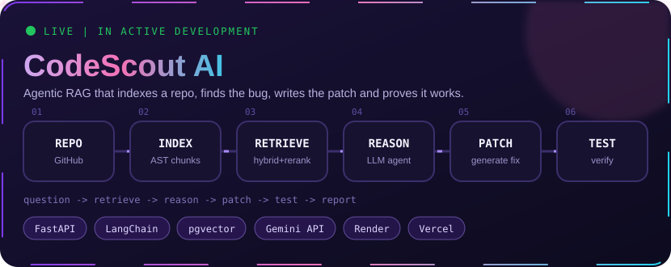</a>
 

 


 

<table>
<tr>
<td width="50%"><a href="https://github.com/Santosh02411/codebase_agent"></a></td>
<td width="50%"><a href="https://missing-persons-network.vercel.app"></a></td>
</tr>
<tr>
<td width="50%"><a href="https://github.com/Santosh02411/cold_weather_EV_range_degradation"></a></td>
<td width="50%"><a href="https://github.com/Santosh02411/social-media-ads-platform"></a></td>
</tr>
<tr>
<td width="50%"><a href="https://github.com/Santosh02411/Malware-detection"></a></td>
<td width="50%"><a href="https://github.com/Santosh02411/Formula-Forge"></a></td>
</tr>
</table>

 

<table>
<tr>
<td width="50%"><a href="https://github.com/Santosh02411/CourtVision-AI"></a></td>
<td width="50%"><a href="https://github.com/Santosh02411/DeepShield-AI"></a></td>
</tr>
<tr>
<td width="50%"><a href="https://github.com/Santosh02411/DataLens-AI"></a></td>
<td width="50%"><a href="https://github.com/Santosh02411/DataSentinel"></a></td>
</tr>
<tr>
<td width="50%"></td>
<td width="50%"></td>
</tr>
<tr>
<td width="50%"><a href="https://github.com/Santosh02411/krushi"></a></td>
<td width="50%"><a href="https://github.com/Santosh02411/Delivery_Sync"></a></td>
</tr>
</table>

 


 

 

 

  

 

 

